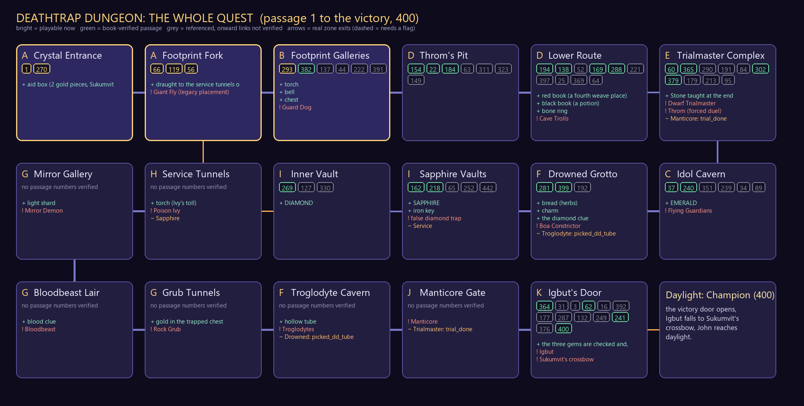

# The whole quest: the Deathtrap Dungeon map

Generated by `python tools/trial/make_quest_map.py render` from `content/trial/quest_map.json`. **Playable** passages are the ones in `content/trial/passages.json`; every other passage is mapped and waiting.

Status of the source: `verified_macrograph_not_full_400_passage_adjacency`. The book has 400 passages; only the verified macrograph below is known edge by edge. A passage marked REFERENCED is the target of a verified edge whose own links are not verified, so none are invented. See `assets/trial/PROVENANCE.md`.



## Order of play

```mermaid
flowchart LR
  dd_entrance["Crystal Entrance<br/>zone A"]
  dd_fork["Footprint Fork<br/>zone A"]
  dd_galleries["Footprint Galleries<br/>zone B"]
  dd_pit["Throm's Pit<br/>zone D"]
  dd_lower["Lower Route<br/>zone D"]
  dd_trialmaster["Trialmaster Complex<br/>zone E"]
  dd_idol["Idol Cavern<br/>zone C"]
  dd_grotto["Drowned Grotto<br/>zone F"]
  dd_vaults["Sapphire Vaults<br/>zone I"]
  dd_vault_inner["Inner Vault<br/>zone I"]
  dd_service["Service Tunnels<br/>zone H"]
  dd_mirror["Mirror Gallery<br/>zone G"]
  dd_blood["Bloodbeast Lair<br/>zone G"]
  dd_grub["Grub Tunnels<br/>zone G"]
  dd_troglodytes["Troglodyte Cavern<br/>zone F"]
  dd_manticore["Manticore Gate<br/>zone J"]
  dd_igbut["Igbut's Door<br/>zone K"]
  dd_exit(["Daylight: Champion (400)"])
  dd_entrance --- dd_fork
  dd_fork ---|fork_east_open| dd_service
  dd_fork --- dd_galleries
  dd_galleries --- dd_pit
  dd_pit --- dd_lower
  dd_lower ---|troll_down| dd_trialmaster
  dd_trialmaster ---|trial_done| dd_manticore
  dd_trialmaster --- dd_lower
  dd_trialmaster ---|trial_done| dd_idol
  dd_idol --- dd_trialmaster
  dd_idol --- dd_grotto
  dd_grotto ---|picked_dd_tube| dd_troglodytes
  dd_grotto --- dd_vaults
  dd_vaults ---|iron_key| dd_vault_inner
  dd_vaults --- dd_service
  dd_vault_inner ---|basket_ok| dd_service
  dd_vault_inner --- dd_vaults
  dd_service --- dd_mirror
  dd_mirror --- dd_blood
  dd_blood --- dd_grub
  dd_grub --- dd_troglodytes
  dd_troglodytes --- dd_manticore
  dd_manticore --- dd_igbut
  dd_igbut ---|the three gems in the right order (the victory door)| dd_exit
```

## Gems and the final lock

* **emerald**: an idol's eye, after the Flying Guardians (zone `dd_idol`, passages 37, 240)
* **sapphire**: a box with an iron key (zone `dd_vaults`, passages 162)
* **diamond**: a later hall route (book); the legacy places it in the inner vault; a false diamond waits in dd_vaults (218) (zone `dd_vault_inner`, passages 269, 330)
* **final use**: Igbut checks all three, then the three-position lock (zone `dd_igbut`, passages 364, 31, 376, 62)

## Zones

| Zone | Design zone | Passages | Items | Encounters | Exits (flag that opens it) |
| --- | --- | --- | --- | --- | --- |
| Crystal Entrance (`dd_entrance`) | A | **1**, **270** | aid box (2 gold pieces, Sukumvit's note) |  | Footprint Fork |
| Footprint Fork (`dd_fork`) | A | **66**, **119**, **56** | draught to the service tunnels once the east loop is walked | Giant Fly (legacy placement) | Service Tunnels (fork_east_open), Footprint Galleries, Crystal Entrance |
| Footprint Galleries (`dd_galleries`) | B | **293**, 382, 137, 44, 222, 391 | torch; bell; chest | Guard Dog | Throm's Pit, Footprint Fork |
| Throm's Pit (`dd_pit`) | D | 154, 22, 184, 63, 311, 323, 149 |  |  | Lower Route, Footprint Galleries |
| Lower Route (`dd_lower`) | D | 194, 138, 52, 169, 288, 221, 397, 25, 369, 64 | red book (a fourth weave place); black book (a potion); bone ring | Cave Trolls | Trialmaster Complex (troll_down), Throm's Pit |
| Trialmaster Complex (`dd_trialmaster`) | E | 60, 365, 290, 191, 84, 302, 379, 179, 213, 95 | Stone taught at the end | Dwarf Trialmaster; Throm (forced duel) | Manticore Gate (trial_done), Lower Route, Idol Cavern (trial_done) |
| Idol Cavern (`dd_idol`) | C | 37, 240, 351, 239, 34, 89 | EMERALD | Flying Guardians | Trialmaster Complex, Drowned Grotto |
| Drowned Grotto (`dd_grotto`) | F | 281, 399, 192 | bread (herbs); charm; the diamond clue | Boa Constrictor | Troglodyte Cavern (picked_dd_tube), Idol Cavern, Sapphire Vaults |
| Sapphire Vaults (`dd_vaults`) | I | 162, 218, 65, 252, 442 | SAPPHIRE; iron key | false diamond trap | Inner Vault (iron_key), Drowned Grotto, Service Tunnels |
| Inner Vault (`dd_vault_inner`) | I | 269, 127, 330 | DIAMOND |  | Service Tunnels (basket_ok), Sapphire Vaults |
| Service Tunnels (`dd_service`) | H | none verified | torch (Ivy's toll) | Poison Ivy | Footprint Fork (fork_east_open), Inner Vault (basket_ok), Sapphire Vaults, Mirror Gallery |
| Mirror Gallery (`dd_mirror`) | G | none verified | light shard | Mirror Demon | Service Tunnels, Bloodbeast Lair |
| Bloodbeast Lair (`dd_blood`) | G | none verified | blood clue | Bloodbeast | Mirror Gallery, Grub Tunnels |
| Grub Tunnels (`dd_grub`) | G | none verified | gold in the trapped chest | Rock Grub | Bloodbeast Lair, Troglodyte Cavern |
| Troglodyte Cavern (`dd_troglodytes`) | F | none verified | hollow tube | Troglodytes | Drowned Grotto (picked_dd_tube), Grub Tunnels, Manticore Gate |
| Manticore Gate (`dd_manticore`) | J | none verified |  | Manticore | Trialmaster Complex (trial_done), Troglodyte Cavern, Igbut's Door |
| Igbut's Door (`dd_igbut`) | K | 364, 31, 3, 62, 16, 392, 177, 287, 132, 249, 241, 376, 400 | the three gems are checked and, on a wrong order, scattered | Igbut; Sukumvit's crossbow | Manticore Gate, Daylight: Champion (400) (the three gems in the right order (the victory door)) |

## Passages

Bold = playable now. Edges are the book-verified wording.

| Passage | Zone | Status | Beat | Verified edges |
| --- | --- | --- | --- | --- |
| **1** | dd_entrance | BOOK_VERIFIED | Crystal-lit entrance tunnel; six boxes including one bearing the contestant's name. | open named box → 270; continue north → 66 |
| 3 | dd_igbut | REFERENCED | Named as the target of a verified edge; its own text and onward links are not verified. | not verified |
| 16 | dd_igbut | REFERENCED | Named as the target of a verified edge; its own text and onward links are not verified. | not verified |
| 22 | dd_pit | BOOK_VERIFIED | Uneasy temporary alliance with the Barbarian; both know only one contestant may win; they reach a deep pit. | accept Barbarian lowering player → 63; offer to lower Barbarian → 184; jump pit together → 311 |
| 25 | dd_lower | REFERENCED | Named as the target of a verified edge; its own text and onward links are not verified. | not verified |
| 31 | dd_igbut | REFERENCED | Named as the target of a verified edge; its own text and onward links are not verified. | not verified |
| 34 | dd_idol | REFERENCED | Named as the target of a verified edge; its own text and onward links are not verified. | not verified |
| 37 | dd_idol | BOOK_VERIFIED | Large idol cavern with fist-sized jewelled eyes and two stuffed bird-like guardians. | climb idol → 351; continue through cavern → 239 |
| 44 | dd_galleries | REFERENCED | Named as the target of a verified edge; its own text and onward links are not verified. | not verified |
| 52 | dd_lower | REFERENCED | Named as the target of a verified edge; its own text and onward links are not verified. | not verified |
| **56** | dd_fork | PROTOTYPE_ENDPOINT | Where the named box (270) and the eastern branch (119) both lead: the soft obstruction opens. Prototype endpoint of the opening. | not verified |
| 60 | dd_trialmaster | BOOK_VERIFIED | Dwarf Trialmaster locks John and Throm in a chamber and says only one may continue. Throm proposes attacking him. | attack Dwarf with Throm → 179; persuade Throm to accept test → 365 |
| 62 | dd_igbut | BOOK_VERIFIED | Final lock has three gem positions. Wrong arrangements cause injury; Igbut gives aggregate positional feedback and allows retries. | six possible gem permutations → [16, 392, 177, 287, 132, 249] |
| 63 | dd_pit | REFERENCED | Named as the target of a verified edge; its own text and onward links are not verified. | not verified |
| 64 | dd_lower | REFERENCED | Named as the target of a verified edge; its own text and onward links are not verified. | not verified |
| 65 | dd_vaults | REFERENCED | Named as the target of a verified edge; its own text and onward links are not verified. | not verified |
| **66** | dd_fork | BOOK_VERIFIED | First major junction: white arrow points west; several footprints went west and one east. | west → 293; east → 119 |
| 84 | dd_trialmaster | REFERENCED | Named as the target of a verified edge; its own text and onward links are not verified. | not verified |
| 89 | dd_idol | REFERENCED | Named as the target of a verified edge; its own text and onward links are not verified. | not verified |
| 95 | dd_trialmaster | REFERENCED | Named as the target of a verified edge; its own text and onward links are not verified. | not verified |
| **119** | dd_fork | BOOK_VERIFIED | Eastern branch loops toward the soft obstruction / opening route. | continue east → 56; return and go west → 293 |
| 127 | dd_vault_inner | REFERENCED | Named as the target of a verified edge; its own text and onward links are not verified. | not verified |
| 132 | dd_igbut | REFERENCED | Named as the target of a verified edge; its own text and onward links are not verified. | not verified |
| 137 | dd_galleries | REFERENCED | Named as the target of a verified edge; its own text and onward links are not verified. | not verified |
| 138 | dd_lower | BOOK_VERIFIED | Black book contains an unknown potion; Throm refuses it and distrusts the unknown. | drink → 397; rub on wounds → 25; red book → 52; continue → 369 |
| 149 | dd_pit | REFERENCED | Named as the target of a verified edge; its own text and onward links are not verified. | not verified |
| 154 | dd_pit | BOOK_VERIFIED | Player catches up with the Barbarian and travels west with him. | continue together → 22 |
| 162 | dd_vaults | BOOK_VERIFIED | A box contains an iron key and a large sapphire. | take items and continue → 442 |
| 169 | dd_lower | BOOK_VERIFIED | Throm hears approaching footsteps first; two Cave Trolls arrive and each adventurer takes one. | win player's Cave Troll fight → 288 |
| 177 | dd_igbut | REFERENCED | Named as the target of a verified edge; its own text and onward links are not verified. | not verified |
| 179 | dd_trialmaster | REFERENCED | Named as the target of a verified edge; its own text and onward links are not verified. | not verified |
| 184 | dd_pit | BOOK_VERIFIED | The Barbarian identifies himself as Throm. His distrust is visible while the player lowers him by rope. | join Throm below → 323; abandon him and cross → 149 |
| 191 | dd_trialmaster | REFERENCED | Named as the target of a verified edge; its own text and onward links are not verified. | not verified |
| 192 | dd_grotto | REFERENCED | Named as the target of a verified edge; its own text and onward links are not verified. | not verified |
| 194 | dd_lower | BOOK_VERIFIED | Two leather-bound books; Throm is contemptuous of reading and urges haste. | red book → 52; black book → 138; continue → 369 |
| 213 | dd_trialmaster | REFERENCED | Named as the target of a verified edge; its own text and onward links are not verified. | not verified |
| 218 | dd_vaults | BOOK_VERIFIED | A room appears to contain a diamond beside a fallen warrior, but entering can be a lethal trap. | enter for apparent jewel → 65; continue → 252 |
| 221 | dd_lower | REFERENCED | Named as the target of a verified edge; its own text and onward links are not verified. | not verified |
| 222 | dd_galleries | REFERENCED | Named as the target of a verified edge; its own text and onward links are not verified. | not verified |
| 239 | dd_idol | REFERENCED | Named as the target of a verified edge; its own text and onward links are not verified. | not verified |
| 240 | dd_idol | BOOK_VERIFIED | After the Flying Guardians are defeated, the emerald eye can be removed. | try other eye → 34; climb down → 89 |
| 241 | dd_igbut | BOOK_VERIFIED | After the final lock route, Igbut is killed by a final Sukumvit crossbow trap and John reaches daylight. | exit → 400 |
| 249 | dd_igbut | REFERENCED | Named as the target of a verified edge; its own text and onward links are not verified. | not verified |
| 252 | dd_vaults | REFERENCED | Named as the target of a verified edge; its own text and onward links are not verified. | not verified |
| 269 | dd_vault_inner | BOOK_VERIFIED | A later hall route allows the player to leave carrying the real diamond. | leave with diamond → 127 |
| **270** | dd_entrance | BOOK_VERIFIED | Named box provides two gold pieces and Sukumvit's warning that several items will be needed. | continue → 56 |
| 281 | dd_grotto | BOOK_VERIFIED | After rescuing the Elf from a Boa Constrictor, she is dying; she reveals that gems unlock the final door and identifies diamond as one required gem. | eat bread → 399; take mirror/charm and continue → 192 |
| 287 | dd_igbut | REFERENCED | Named as the target of a verified edge; its own text and onward links are not verified. | not verified |
| 288 | dd_lower | BOOK_VERIFIED | Throm has killed his troll but is wounded. A druidic bone ring is found; he refuses to touch it and advises against it. | wear ring → 64; continue with Throm → 221 |
| 290 | dd_trialmaster | REFERENCED | Named as the target of a verified edge; its own text and onward links are not verified. | not verified |
| **293** | dd_galleries | BOOK_VERIFIED | Three sets of footprints divide: two west, one north. | follow two sets west → 137; follow one set north → 382 |
| 302 | dd_trialmaster | BOOK_VERIFIED | The Dwarf later sends in a wounded, delirious Throm. The cobra has bitten him. John protests but must defend himself. | defeat Throm → 379 |
| 311 | dd_pit | REFERENCED | Named as the target of a verified edge; its own text and onward links are not verified. | not verified |
| 323 | dd_pit | REFERENCED | Named as the target of a verified edge; its own text and onward links are not verified. | not verified |
| 351 | dd_idol | REFERENCED | Named as the target of a verified edge; its own text and onward links are not verified. | not verified |
| 364 | dd_igbut | BOOK_VERIFIED | After the Manticore, Igbut the Gnome appears as final Trialmaster and checks for the three required gems. | has emerald → 31; missing emerald → 3 |
| 365 | dd_trialmaster | BOOK_VERIFIED | John persuades Throm to accept the Trialmaster's procedure; the Dwarf takes John through a secret door and begins a dice-probability test. | predict same as 8 → 290; predict less than 8 → 191; predict more than 8 → 84 |
| 369 | dd_lower | REFERENCED | Named as the target of a verified edge; its own text and onward links are not verified. | not verified |
| 379 | dd_trialmaster | BOOK_VERIFIED | After Throm dies, John hates the Dwarf. The Dwarf keeps John at crossbow point and reveals the concealed way onward. | enter new tunnel → 213; punch Dwarf → 95 |
| 382 | dd_galleries | BOOK_VERIFIED | Old man's statue riddle; the player recognizes the petrified Knight who entered the Trial first. | answer 100 → 44; answer 150 → 222; answer 200 → 391 |
| 391 | dd_galleries | REFERENCED | Named as the target of a verified edge; its own text and onward links are not verified. | not verified |
| 392 | dd_igbut | REFERENCED | Named as the target of a verified edge; its own text and onward links are not verified. | not verified |
| 397 | dd_lower | REFERENCED | Named as the target of a verified edge; its own text and onward links are not verified. | not verified |
| 399 | dd_grotto | BOOK_VERIFIED | The Elf's bread contains healing herbs; the player packs away the mirror and charm and continues north. | continue → 192 |
| 400 | dd_igbut | BOOK_VERIFIED | Victory: the surviving contestant emerges to Fang and is acclaimed as Champion. | (endpoint) |
| 442 | dd_vaults | REFERENCED | Named as the target of a verified edge; its own text and onward links are not verified. | not verified |

## Contestants

* **knight**: enters first; fate: later recognized as a petrified statue (passages 382)
* **elf**: enters second; fate: mortally wounded after Boa Constrictor; gives diamond clue if rescued (passages 281)
* **throm**: one of the two Barbarian contestants; one Barbarian enters before the player (passages 154, 22, 184, 194, 169, 288, 60, 365, 302, 379, 449)
* **black_clad_assassin**: enters fourth
* **second_barbarian**: present among the six contestants

## Major encounters

| Encounter | Book role | Dungeon role | Here |
| --- | --- | --- | --- |
| Flying Guardians | Creature combat | Idol/emerald defence | Two small sequential or multi-target Duel Master encounters |
| Giant Fly | Creature combat with escape | Optional hazard | 1–2 slot fast Duel Master encounter |
| Cave Trolls | Parallel combat with Throm | Companion set-piece | John duels one while Throm visibly handles the other |
| Mirror Demon | Monster + environmental solutions | Signature puzzle-combat | Only launch Duel Master if player chooses direct combat |
| Bloodbeast | High-danger monster with special weakness | Knowledge-sensitive encounter | Multi-slot Duel Master boss with pre-battle advantage if weakness learned |
| Troglodytes | Tribe / pursuit / ritual | Traversal-social hazard | Run of the Arrow and river escape stay traversal; direct fight can use representative formation encounter |
| Medusa | Lethal gaze/test | Trap/monster set-piece | Primarily environmental/choice challenge |
| Poison Ivy | Extortion/social encounter | NPC hazard | Dialogue/payment/escape; optional Duel Master only on attack |
| Rock Grub | Fight or retreat | Environmental monster | 2–3 slot Duel Master encounter |
| Pit Fiend | Major creature combat | Boss-like obstacle | 3–4 slot Duel Master battle |
| Manticore | Major final monster combat | Gate to Igbut | 4-slot Duel Master boss |
| Throm | Forced contestant fight | Emotional climax | Full Duel Master battle |
| Igbut gem lock | Logic puzzle | Final test | Use Duel Master visual language but preserve three gems / positional feedback |
