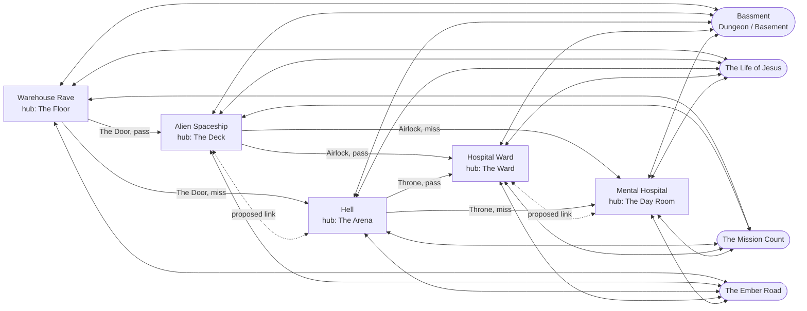
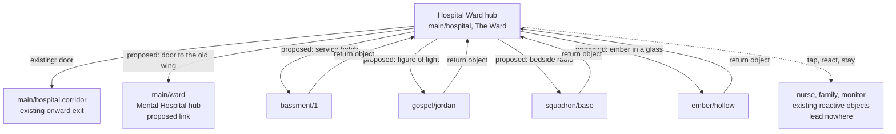

# Narrative graph: how the player moves between locations and quests

Status: planning document, 6 November 2026. No game code was written for it. It is deliverable D1 of
`ONE_PC_PLAN.md` and the design that stages N1 and N2 build.

Where this document speaks of "the music stream" and "the narrative stream", it means the two streams of
`ONE_PC_PLAN.md` section 4. The narrative stream owns this design. The two streams meet only at
`contract/transition_port.gd` and `INTEGRATION_CONTRACT.md`.

Reviewed on 6 November 2026 against `LEAD_RULINGS.md`, which is binding and later than this text. Rulings 15 to 19 are applied here and in
the data files: an ungated Dungeon entrance in every hub (20 new entrances), hubs of up to 10 objects, the seven extra path routes accepted
as the working design, the walkable order of the second route, and the Bassment exception (41 passages).

Marks used throughout: **existing** (in the repository now), **partial** (exists in another form or place),
**proposed** (this design). Anything not marked is a statement of fact about the repository's data on this branch.

Files that go with this document, all in `graph/`:

| File | What it is |
|---|---|
| `graph_today.json` | Today's route graph: 148 nodes, 700 edges, unchanged copy of the inventory's machine-readable graph. Its ids are the old style (`warehouse`, `gospel:jordan`, `bassment:1`). |
| `narrative.schema.md` | Field-by-field schema of the new overlay file, format `rhythm_warfare.narrative.v1`. |
| `overlay_proposed.json` | A complete proposed overlay instance. |
| `narrative_graph_target.json` | The target graph: 146 nodes, 960 edges, ids in the contract's `"<path>/<node>"` form. |
| `validation_report.md` | The output of the check script on paper, with numbers and what it could not check. |

The planning inputs behind the findings (the architects' reports, the decisions file) are not in the repository. Their findings
are restated here where needed, with the numbers.

## 1. Today

### 1.1 The five locations and four quests in the existing data

A trap in the names: the world id `hospital` is the Hospital Ward (its first scene is titled "The Ward"). The world id `ward`
is the Mental Hospital (also titled "The Ward"; its first scene is "The Day Room").

| Owner's location | Exists as | Scenes | Hub scene (entry scene) | Status |
|---|---|---|---|---|
| Warehouse Rave | world `warehouse` | 6 | `main/warehouse`, The Floor | existing |
| Hospital Ward | world `hospital`, plus `hospital_late` | 6 + 4 | `main/hospital`, The Ward | existing |
| Mental Hospital | world `ward`, plus `ward_late` | 6 + 4 | `main/ward`, The Day Room | existing |
| Alien Spaceship | world `mothership` | 5 | `main/mothership`, The Deck | existing |
| Hell | world `underworld` | 5 | `main/underworld`, The Arena | existing (its music is a marked stand-in) |

`hospital_late` and `ward_late` are the two looping worlds a run lives in after the Bandstand or the Stage. They reuse the
Hospital and Mental Hospital maps. In this design they are parts of those two locations.

| Owner's quest | Exists as | Scenes | Entry scene | Music | Status |
|---|---|---|---|---|---|
| Dungeon / Basement | The Bassment, the separate trial system in `src/trial` | 64 passages (56 normal, 7 death, 1 victory) | `bassment/1` | Its own: `dd_part1`, fight `dd_part2` | existing, complete |
| Jesus | path `gospel`, "The Life of Jesus" | 17 | `gospel/jordan` | `track_scenes.json`, path `gospel` | existing; placeholder music before the track overhaul |
| Catch-22 | path `squadron`, "The Mission Count" | 14 | `squadron/base` | `track_scenes.json`, path `squadron` | existing |
| Lord of the Rings | path `ember`, "The Ember Road" | 15 | `ember/hollow` | `track_scenes.json`, path `ember` | existing |

The owner's labels in the first column name the slots. The repository's own names are used everywhere else (decision 4, section 8).
A fifth path, `stub`, is a developer test. It is not part of the shipped run and the target graph leaves it out.

All 82 non-Bassment scenes have an entry in `content/run/track_scenes.json` (36 main, 17, 14, 15). The paper check confirms this (`validation_report.md`, rule 8).

### 1.2 The measured gaps

All numbers are computed from the data (`graph_today.json`, `validation_report.md` section 1).

| Requirement | Today | Gap |
|---|---|---|
| Every location offers every quest | 4 of 20 cells filled, all in the Warehouse. The wizard (Floor and Chill-out), the star (Balcony), the radio (Booth), the ember (Bar). | 16 empty |
| Each quest within five choices of the start | Fewest visible choices: Bassment 1, Squadron 3, Gospel 25, Ember 25. The inventory's 6 for Gospel and Ember uses the Bassment's back key, which is a hidden option and does not count. | 2 of 4 fail |
| Entry never rhythm-gated, no other quest needed | All four entries need a passed block. The star needs `wh_saw_floor` first, the ember needs `wh_vip_pass` (from a passed block at the stranger). A missed stranger locks the ember out for the run. The wizard works only in blocks 1 and 2 and only once a run (`wh_wizard_met`). | all four |
| Leave a quest for the mainline from every scene | Visible authored way back on 13 of 110 quest scenes (5 of 46 path scenes, and 7 death passages plus the victory passage). Every scene also has a hidden leave: the pause menu "Leave this path" (46) or the system back key (64). | 97 scenes with only a hidden leave |
| Return lands where the player entered | Always The Floor (`RunPlay._path_swap` sets `start = "warehouse"`; `trial_leave` resumes `warehouse`). | no return checkpoint exists |
| Re-entry keeps progress | A fresh `RunEngine` is built at each hand-off. Re-entry starts at the quest's first scene. The Bassment restarts at passage 1 with no items. Only the `keep:` flags persist, and none gates anything. | nothing kept |
| Three meaningful choices in every scene | Distinct destinations from a scene: main run 1 in 18 scenes, 2 in 15, 3 in 3 (the Floor, the Bar, the Balcony). Quest scenes: 1 to 2 destinations (Ember up to 3). Bassment: 62 of 64 passages show fewer than three choices. | 33 of 36 main scenes, most quest scenes, 62 Bassment passages |
| One run can visit the five locations | A run visits three: Warehouse, then Alien Spaceship or Hell, then Hospital Ward or Mental Hospital. Alien and Hell exclude each other, so do Hospital and Mental Hospital. No route back to the Warehouse. No ending. | 2 of 5 unreachable in one run |
| State to remember | Nothing about route is saved. There is no route history and no return checkpoint. `RunProgress` saves `reached`, `flags` (only `keep:`), `paths`, `wallet`, `seed`, run counts. | route state missing |

One more fact found while building the target: `graph_today.json` has no edge for a lost fight in the Bassment. The engine sends a fight
lost three times to passage 0 ("Defeated") (`src/trial/trial_flow.gd`). The target graph adds those 10 edges (existing behaviour, absent from the old graph file).

## 2. Target model

### 2.1 What is decided, and what is added by this design

| Item | Source | Status |
|---|---|---|
| A derived graph, built from the existing run, path and Bassment data plus one overlay file | design decision D3 | proposed |
| Five locations, each with one hub scene showing all four quest entrances and at least one mainline exit | D3 | proposed |
| Quest entry is never rhythm-gated and never needs another quest | D3, lead ruling 15 | proposed (the wizard stays as an extra, gated way in; he is not the Dungeon entrance) |
| Every quest scene has a return object; the return lands on the hub of the location entered from | D3 | proposed |
| Progress per quest, saved; re-entry resumes; a completed quest restarts and keeps `completed` | D3 | proposed |
| Three choices everywhere | D3, lead ruling 19 | proposed (exception: 41 Bassment passages) |
| Mainline routes kept as they are, plus hub-to-hub links between the paired locations, no ending yet | owner, 6 Nov 2026 | proposed |
| `to_hub` routes, extra entrances on non-hub scenes, `restart` and second routes | this design, to make rule 5 hold in the data | proposed |

### 2.2 Locations, hubs and the objects they hold

A **hub scene** is the first scene of a location. It shows the four quest entrances, at least one mainline exit and, for the paired
locations, a link to the partner hub. Other scenes of a location may show any subset of entrances.

The choice count in the hubs (distinct destinations, from `validation_report.md`): Warehouse 6, Hospital Ward 6, Mental Hospital 7, Alien Spaceship 7, Hell 7.

Hub-to-hub links (the owner's decision 3). All four are **proposed**:

| From | To | Object (id) | Illustrative idea |
|---|---|---|---|
| `main/mothership` | `main/underworld` | `mothership.to_underworld` | A rift in the deck floor, red light below |
| `main/underworld` | `main/mothership` | `underworld.to_mothership` | A beam of cold light through a hole in the arena ceiling |
| `main/hospital` | `main/ward` | `hospital.to_ward` | A door to the old wing, a sign half scratched off |
| `main/ward` | `main/hospital` | `ward.to_hospital` | A door to the general ward with a window of clean light |

With these links a run can visit all five locations: Warehouse, Alien Spaceship, Hell, Hospital Ward, Mental Hospital.
The mainline has no route back to the Warehouse. That is the owner's decision (no new routes beyond the paired links), and the check
confirms it (rule 4).

### 2.3 The 20 hub entrances (20 new entrances, lead ruling 15)

One object per (location, quest) cell, in the hub scene. Every object idea is **illustrative**: the visual design belongs to the
interaction work (`INTERACTION_DESIGN.md`), and the ids are suggestions that the content stage may rename.

Three Warehouse entrances exist today in other rooms. Because a hub must show all four, the existing object is reused and a copy of it is
placed on the Floor (status partial). The original stays where it is, now ungated, so today's routes still work.

| Location | Quest | Hub scene | Object id | Status | Where it lives today | Illustrative idea |
|---|---|---|---|---|---|---|
| Warehouse Rave | Bassment | `main/warehouse` | `warehouse.enter_bassment` | proposed | none. The wizard (`warehouse.wizard` on the Floor, `warehouse.chill.wizard` in the Chill-out) stays as an extra way in, gated by a passed block in blocks 1 and 2 and by `wh_wizard_met` | A cellar hatch in the Floor beside the bar door, taken at the lap's end through the port like the other three |
| Warehouse Rave | Jesus | `main/warehouse` | `warehouse.enter_gospel` | partial | `warehouse.balcony.star` in the Balcony, gated by `wh_saw_floor` and a passed block | The projected star, copied to a stack on the Floor |
| Warehouse Rave | Catch-22 | `main/warehouse` | `warehouse.enter_squadron` | partial | `warehouse.booth.radio` in the Booth, gated by a passed block | The military radio, copied to a speaker stack |
| Warehouse Rave | Lord of the Rings | `main/warehouse` | `warehouse.enter_ember` | partial | `warehouse.bar.ember` in the Bar, gated by `wh_vip_pass` and a passed block | The ember in a glass, copied to a table at the edge of the Floor |
| Hospital Ward | Bassment | `main/hospital` | `hospital.enter_bassment` | proposed | none | A service hatch with chalk marks behind the nurses' station |
| Hospital Ward | Jesus | `main/hospital` | `hospital.enter_gospel` | proposed | none | A figure of light under a star-shaped lamp above a bed |
| Hospital Ward | Catch-22 | `main/hospital` | `hospital.enter_squadron` | proposed | none | A crackling wartime radio on a bedside table |
| Hospital Ward | Lord of the Rings | `main/hospital` | `hospital.enter_ember` | proposed | none | A small ember in a water glass on the locker |
| Mental Hospital | Bassment | `main/ward` | `ward.enter_bassment` | proposed | none | A cellar hatch under the day-room radiator |
| Mental Hospital | Jesus | `main/ward` | `ward.enter_gospel` | proposed | none | A figure of light in the day-room window, under a drawn star |
| Mental Hospital | Catch-22 | `main/ward` | `ward.enter_squadron` | proposed | none | A military radio on the shelf beside the cards table |
| Mental Hospital | Lord of the Rings | `main/ward` | `ward.enter_ember` | proposed | none | An ember in a tea glass left on the table |
| Alien Spaceship | Bassment | `main/mothership` | `mothership.enter_bassment` | proposed | none | A maintenance hatch in the deck plating |
| Alien Spaceship | Jesus | `main/mothership` | `mothership.enter_gospel` | proposed | none | A figure of light under a single star in the viewport |
| Alien Spaceship | Catch-22 | `main/mothership` | `mothership.enter_squadron` | proposed | none | An old military radio wired into a comms console |
| Alien Spaceship | Lord of the Rings | `main/mothership` | `mothership.enter_ember` | proposed | none | An ember glowing in a specimen jar |
| Hell | Bassment | `main/underworld` | `underworld.enter_bassment` | proposed | none | A trapdoor in the arena sand with a ladder |
| Hell | Jesus | `main/underworld` | `underworld.enter_gospel` | proposed | none | A figure of light standing under one white star in the dark |
| Hell | Catch-22 | `main/underworld` | `underworld.enter_squadron` | proposed | none | A military radio hanging from the chains |
| Hell | Lord of the Rings | `main/underworld` | `underworld.enter_ember` | proposed | none | A small ember in a glass beside the furnace mouth |

Totals: 0 existing, 3 partial, 17 proposed, 20 new entrances in all (lead ruling 15, which replaces ruling 2's 19). The 16 empty cells of section 1.2
are the 16 in the four new hubs; the Floor adds the three copies and the new hatch.

The wizard stays as he is (decision 5, ruling 15): mid-scene, outside the port, rhythm-gated, once a run. He is now an **extra** way into the Bassment
from the Floor and the Chill-out, not the Floor's Dungeon entrance. He is a declared, named exception (`legacy_wizard_entrance`) and the validator
reports him as an exception. Because the Floor has its own ungated hatch, every quest is 1 choice from the start without the wizard.

The route to every quest entrance from the start is 1 choice, and none of the four needs a passed block.

### 2.4 The other routes the overlay adds

| Route | Where | Count | Status | Why |
|---|---|---|---|---|
| Hub entrances | 5 hubs x 4 quests | 20 (17 new objects and 3 copies) | see 2.3 | Rules 1 and 2 |
| Hub-to-hub links | Alien <-> Hell, Hospital <-> Mental Hospital | 4 | proposed | Decision 3 |
| `to_hub` | every mainline scene that is not a hub: 31 | 31 | proposed | Rule 2: a quest from every scene of a location, in at most 2 choices. Also a third choice. |
| Extra entrances | non-hub mainline scenes that still have only two destinations: 17 (list below) | 17 | proposed | Rule 5 |
| `return` | every quest scene: 110, from 4 definitions | 110 | proposed | Rule 3 |
| `back` | path scenes: 43 scenes with a predecessor, 79 edges | 79 | proposed | Rule 5 |
| `restart` | the 5 ending scenes (`gospel/jerusalem.tomb`, `gospel/jerusalem.road`, `squadron/escape.c13`, `ember/mountain.spring`, `ember/mountain.keeper`) back to the quest's first scene | 5 | proposed | Rule 5; follows D3 (a completed quest restarts at its first scene) |
| Second route | `gospel/jordan` to `gospel/jordan.nazareth`; `ember/hollow` to `ember/hollow.inn` | 2 | proposed, **needs review** | Rule 5: both entry scenes have only one onward scene. The destinations were chosen only so the graph is valid. |

Extra entrances (all proposed; the quest picked by rotation, so the owner or the content stage may choose another):
`mothership.gallery` Bassment, `mothership.reactor` Jesus, `mothership.bridge` Catch-22, `underworld.court` Bassment, `underworld.furnace` Jesus,
`underworld.pit` Catch-22, `hospital.dayroom` Bassment, `hospital.cafeteria` Jesus, `hospital.garden` Catch-22, `ward.art` Bassment, `ward.dorm` Jesus,
`ward.corridor` Catch-22, `ward.courtyard` Lord of the Rings, `hospital_late.cafe` Lord of the Rings, `hospital_late.quiet` Bassment,
`ward_late.treat` Bassment, `ward_late.dorm` Jesus. The Warehouse's non-hub scenes need none: they already offer three or more.

Existing edges the design changes (status changed):

| Change | Count |
|---|---|
| The star, radio and ember entrances lose the passed-block gate, the `on_miss` route and the `wh_saw_floor` / `wh_vip_pass` conditions | 3 objects |
| Authored ways back from quest endings land on the checkpoint, not the Floor, and lose their `on_miss` twin | 18 edges on 13 scenes |
| The hidden leaves (pause menu, back key) stay, land on the checkpoint, and never count as a choice | 110 |

The `wh_vip_pass` flag still exists for the Door's bouncer. The stranger at the Bar stays as a flavour object; he no longer locks anything.

### 2.5 The three-choice rule

A **choice** is a visible object that leads to a distinct destination. Rules for counting:

- An object that only changes flags or energy and leads where another object leads is not a choice. It may be a reactive object.
- "Stay in this scene" is not a choice.
- A hidden option (pause menu, back key) is not a choice.
- An option that needs a flag the player has not got is not counted.
- `$checkpoint` (the return) is one destination.

What each kind of scene shows:

| Scene | Choices | Status |
|---|---|---|
| Hub | onward exit(s) of the location, 4 quest entrances, a link to the partner hub (paired locations) | proposed |
| Other mainline scene | the existing onward exits, a way to the hub (`to_hub`), and one extra quest entrance if that is still under three | proposed |
| Quest scene | the existing onward routes, back to the previous scene, return to the mainline | proposed |
| Quest ending or entry scene | as above plus `restart` (endings) or a second route (entry scenes) | proposed, needs review |
| Bassment passage | its own choices plus the return | proposed; 41 of 64 still under three |

Result on the target graph: 105 of 146 scenes have three or more distinct destinations. All 36 mainline scenes and all 46 path scenes do. The
remaining 41 scenes are Bassment passages, declared as the named exception `bassment_passages_under_three`.

The design differs from DECISIONS.md in one place here: D3 says onward, back and return "alone give three with no new story content". That is
false for 7 scenes of the paths (the two entry scenes have no previous scene; the five ending scenes have only the return as onward route). They need
the `restart` and second-route routes above.

### 2.6 The Bassment's special position

The Bassment is a different system: text-and-choice passages in `src/trial`, its own engine, entered mid-scene by the wizard. In this design:

| Point | Phase 1 (stages N1 and N2) | Later piece |
|---|---|---|
| It is a node set in the graph (`bassment/<passage>`) | yes | |
| It has a visible return in every passage | yes (proposed) | |
| It is entered from the four other hubs | yes, through the port (proposed) | |
| The wizard's mid-scene entrance | stays as it is (decision 5), a declared exception | moved behind the port (`when: soonest`) |
| Passages with fewer than three choices | 41 of 64 declared as a named exception | raised, separately sized |
| It saves progress | passage and carried items | |
| Death and victory passages | existing returns, re-pointed to the checkpoint. Only passage 63 sets `completed`. | |

Open technical point (missing, complex / uncertain): `TrialScene` runs its own engine and does not use the port's lap and boundary model. How
a port request is made from inside a passage, and how the port starts the trial for the four hub entrances, needs a spike at the start of
N2.2. The conformance cases are written for laps, not for passages.

## 3. Route state

### 3.1 Fields

`RouteState` lives in `src/narrative/` (proposed). It has a committed copy, which is what is saved, and at most one pending change.

| Field | Type | Meaning | Saved |
|---|---|---|---|
| `location` | location id | Current mainline location. Set when a mainline scene is entered. It does not change while a quest is running. | yes |
| `quest` | quest id or `""` | The quest the player is in now. | yes |
| `entry_origin` | graph id or `""` | The scene whose object started the current quest. Empty outside a quest. | yes |
| `checkpoint` | graph id or `""` | Where a return lands: the hub of the location of `entry_origin`. Empty outside a quest. | yes |
| `quest_progress` | map quest id to `{scene, completed, visits, flags or items}` | Progress per quest. See 3.4. | yes |
| `history` | array of graph ids, at most 32 | Scenes entered, newest last. The last element is the current scene. Used for `back`. | yes |
| `pending` | `{id, dest, change}` | The change computed for the request in flight. | **no**, memory only |
| existing run state | `RunProgress.run_flags`, energy, phase count, `keep:` flags, `paths`, wallet, seed | | as today |

Invariants (checked on the paper model, `validation_report.md` rules 9 and 10): `quest`, `entry_origin` and `checkpoint` are all empty or all set;
`checkpoint` is the hub of `entry_origin`'s location; `location` is that location while `quest` is set; the current scene belongs to `quest`;
`history` is at most 32 and ends at the current scene; a quest's saved scene belongs to that quest.

Reading of D3 worth stating: an extra entrance on a non-hub scene records that scene as `entry_origin`, but the checkpoint is still the hub of its location, as D3
says ("the hub scene of the location the player entered from"). The player returns to the hub, not to the room.

### 3.2 The transaction rule

This is the rule of `INTEGRATION_CONTRACT.md` section 5, applied to route state.

1. `QuestRouter` builds a `Destination` and computes the change to route state. It holds the change against the request id as `pending`. Nothing committed changes.
2. The change is applied and saved **only in the handler of `switched`**, from the `landed` dictionary and not from what was asked for.
3. If `landed["fallback"]` is true, the router recomputes the change for the scene really entered.
4. `request_closed` (replaced, cancelled, unavailable) and `deferred` never touch the committed copy.
5. The save is atomic: a temporary file, then a rename.
6. A destination that cannot be loaded is found before the lock and closed `unavailable`. After the lock, a failure fails forward to `landed`, so the saved state matches where the player is.
7. Effects that are saved at the lock today (a `keep:` flag at beat 60.5) move to `switched`.
8. One exception, until the later piece: the wizard's legacy entrance is outside the port. Its change is committed when the trial begins (`trial_begin_now`). It is the only commit not made on `switched`, and it is in the exception list.

The per-request flow, as the port sees it: `request` (acknowledged at once), possibly replaced or cancelled, `locked` at the lock point, `switched` at the boundary,
`completed` when the outgoing music is silent. Route state changes at `switched` only. Music is not cut by a quest change because the request goes through the port.

### 3.3 Save format

The save file is `user://story_run.json`, written by `RunProgress` (VERSION 2, atomic, a bad file set aside as `.corrupt`). The design adds one key, `narrative`,
with its own version. This follows the precedent of `paths`, which was added to the same file without raising the file's version (`run_progress.gd` adds a missing key on load).

Worked example: the end of route 1 in section 4 (a Bassment visit from the Warehouse, then the Hospital Ward and a short Gospel visit). The existing keys are shown cut.

```json
{
  "version": 2,
  "reached": { "...": "..." },
  "flags": { "...": "..." },
  "paths": { "...": "..." },
  "wallet": { "...": "..." },
  "narrative": {
    "version": 1,
    "location": "hospital_ward",
    "quest": "",
    "entry_origin": "",
    "checkpoint": "",
    "quest_progress": {
      "bassment": { "scene": "bassment/3", "completed": false, "visits": 1, "items": [] },
      "gospel": { "scene": "gospel/jordan.baptism", "completed": false, "visits": 1, "flags": [] }
    },
    "history": [
      "main/warehouse", "bassment/1", "bassment/3", "main/warehouse", "main/warehouse.bar",
      "main/warehouse.chill", "main/warehouse.exit", "main/mothership", "main/mothership.gallery",
      "main/mothership.bridge", "main/mothership.exit", "main/hospital", "gospel/jordan",
      "gospel/jordan.baptism", "main/hospital"
    ]
  }
}
```

A quest that was never entered has no entry in `quest_progress`; the reader treats a missing quest as `{scene: "", completed: false, visits: 0}`.

Loading rules (proposed):

- A save without `narrative` loads with the default state (location of the Warehouse, no quest, empty progress). Nothing is lost.
- A `narrative.version` newer than the build knows is ignored; the existing keys load, and the unknown key is not overwritten until the build can read it.
- A save written with `quest` set (a restart in the middle of a quest) is closed on load: the player starts on the `checkpoint` hub, with all progress kept. A full resume inside the quest is not required.
- Migration: when `narrative` is absent and `paths.<path>.endings` is not empty, that quest's `completed` starts true.

### 3.4 Re-entry, completion, and what happens to the old state

| Event | Rule |
|---|---|
| Leave a quest by the return | `quest_progress[q].scene` = the scene the player left. `quest`, `entry_origin`, `checkpoint` are cleared. The player lands on the checkpoint hub, at the start of that scene. |
| Enter a quest never entered | Lands on `entry`. `visits` = 1. |
| Enter a quest left unfinished | Resumes at the start of the saved scene. `visits` + 1. Quest flags (for a path) or items (for the Bassment) are restored. |
| Land on a completion scene | `completed` = true. It is never cleared. |
| Enter a completed quest | Restarts at `entry`. `completed` stays true. `visits` + 1. |
| Die in the Bassment (passage 0, 13, 22, 33, 39, 50, 60) | The existing "Wake in the Warehouse" return lands on the checkpoint. Proposed rule, not in the paper model: the saved scene is the last passage before the death passage (from the history), so a re-entry resumes alive. Not a completion. |
| Quit mid-quest | Closed on load, as above. |

The existing state:

| State | What happens |
|---|---|
| `keep:` flags (`keep:path_gospel_tomb`, ...) | Unchanged. They gate nothing today and still do not. They are saved at `switched` now, not at the lock. |
| `paths` (`reached`, `endings`) | Unchanged. The home screen's lists still read them. `completed` is derived from the same event. |
| Run flags (`wh_*`, `ember_*`, `sq_*`, `gospel_*`, `hp_*`, `ms_*`, `wd_*`) | Still in memory, cleared by `run_started`. The quest's prefixed flags are copied into `quest_progress` on leaving and restored on entering, so a re-entered Ember keeps `ember_no_vial`. |
| Energy, phase count | Carry across a quest and back, as today. |
| `wh_wizard_met` | Stays for the legacy wizard (once a run). It no longer blocks the four port entrances. |
| `Start from a reached level` inside a quest world | Starts the quest at its entry with the Warehouse hub as checkpoint (proposed default; to be settled in N2.2). |

## 4. Entry and exit walk-throughs

The three routes below were run on a paper model of the specified `RouteState` over the target graph (`validation_report.md`, rules 9 and 10; the model is not code).
Each step is a request through the port. In every step the committed state changes only at `switched`. The mainline rows between the quest visits are collapsed.

Notation: a "choice" is one object touched. Each route lists the player's choices.

### 4.1 Route 1: Warehouse to the Bassment and back, then Hospital Ward to Jesus and back

| # | Player does | Port / router | State after (changed fields) |
|---|---|---|---|
| 1 | New run on the Floor | start `main/warehouse` | `location` warehouse_rave; `quest` -; `history` [main/warehouse] |
| 2 | Taps the wizard on the Floor (legacy, mid-scene) | not through the port; committed at `trial_begin_now` | `quest` bassment; `entry_origin` main/warehouse; `checkpoint` main/warehouse; scene `bassment/1`; `visits` 1 |
| 3 | Passage 1: "Climb down the ladder" | inside the Bassment | scene `bassment/3` |
| 4 | Passage 3: touches the return object | `request` quest_return, dest = `main/warehouse`, locked, switched | `quest` -; `entry_origin` -; `checkpoint` -; `quest_progress.bassment.scene` bassment/3; on the Floor, at the start of the scene |
| 5 to 12 | Bar, Chill-out, Door, Deck, Gallery, Bridge, Airlock, Hospital (8 mainline choices) | scene requests | `location` hospital_ward; `node` main/hospital |
| 13 | Taps the figure of light at the Hospital Ward hub | `request` quest_entry, dest = `gospel/jordan`; locked; switched | `quest` gospel; `entry_origin` main/hospital; `checkpoint` main/hospital; `visits` 1 |
| 14 | Follows the road | scene request | scene `gospel/jordan.baptism` |
| 15 | Touches the return object | `request` quest_return, dest = `main/hospital` | quest fields cleared; `quest_progress.gospel.scene` gospel/jordan.baptism; back on the hub |

Choices: 1 (wizard) + 2 (ladder, return) + 8 mainline + 3 (entrance, road, return) = 14 touches in all; the Hospital Ward's Gospel entrance was 1 choice from the hub.
The state at step 15 is the JSON example in 3.3.

### 4.2 Route 2: Alien Spaceship to Ember and back, then Mental Hospital to Squadron, back, and in again

The owner's example order was Mental Hospital first, then Alien Spaceship. That cannot be walked in this design. There is no route from the Mental Hospital to the Alien
Spaceship (the owner's decision keeps today's one-way mainline). The route runs the other way, which the mainline allows.

| # | Player does | Port / router | State after (changed fields) |
|---|---|---|---|
| 1 to 4 | Bar, Chill-out, Door, Alien Spaceship door | scene requests | `location` alien_spaceship; `node` main/mothership |
| 5 | Taps the ember in the jar at the Alien Spaceship hub | quest_entry, dest = `ember/hollow` | `quest` ember; `entry_origin` main/mothership; `checkpoint` main/mothership; `visits` 1 |
| 6 | Through the orchard gate | scene request | scene `ember/hollow.ford` |
| 7 | Return object | quest_return, dest = `main/mothership` | quest fields cleared; `quest_progress.ember.scene` ember/hollow.ford |
| 8 to 11 | Gallery, Bridge, Airlock, Mental Hospital door | scene requests | `location` mental_hospital; `node` main/ward |
| 12 | Taps the military radio at the Mental Hospital hub | quest_entry, dest = `squadron/base` | `quest` squadron; `entry_origin` main/ward; `checkpoint` main/ward |
| 13 | Touches the cot | scene request | scene `squadron/base.c03` |
| 14 | Return object | quest_return, dest = `main/ward` | `quest_progress.squadron.scene` squadron/base.c03; cleared |
| 15 | Taps the radio again | quest_entry; the router replaces the entry by the saved scene | lands on `squadron/base.c03`, not the Briefing Room; `visits` 2 |

Also in this route: the Ember is still unfinished at the end, with its saved scene. Entering it again from any hub would resume at the Ford.

### 4.3 Route 3: Hell to the Bassment and back, then Jesus and back, with a change of mind

| # | Player does | Port / router | State after (changed fields) |
|---|---|---|---|
| 1 to 4 | Bar, Chill-out, Door, Underworld door | scene requests | `location` hell; `node` main/underworld |
| 5 | Taps the trapdoor at the Hell hub | quest_entry, dest = `bassment/1` | `quest` bassment; `entry_origin` main/underworld; `checkpoint` main/underworld |
| 6 | Passage 1: "Climb down the ladder" | scene request | scene `bassment/3` |
| 7 | Return object | quest_return, dest = `main/underworld` | `quest_progress.bassment.scene` bassment/3; cleared |
| 8 | Taps the figure of light, then changes mind (the request closes `cancelled` before the lock) | `request_closed(id, cancelled)`; router discards `pending` | committed state byte for byte as after step 7 |
| 9 | Taps the figure of light again | quest_entry, dest = `gospel/jordan` | `quest` gospel; `entry_origin` main/underworld; `checkpoint` main/underworld |
| 10 | Return object at once (in the first scene) | quest_return, dest = `main/underworld` | `quest_progress.gospel.scene` gospel/jordan; cleared |
| 11 | Taps the figure of light | quest_entry; the router replaces the entry by the saved scene | lands on `gospel/jordan`, `visits` 2 |

Failure case that the conformance suite covers (cases 3, 8 and 10): a destination that fails after the lock lands on `landed` with `fallback` true; the router recomputes the change, so the saved
`location`, `quest` and `checkpoint` describe the scene the player is really on.

## 5. Diagrams

### 5.1 The target at location and quest level

Solid arrows are today's mainline routes. Dotted double arrows are the proposed hub-to-hub links. Each location also has an entrance to, and a return from,
every quest (20 two-way edges, shown as thin lines). The two late worlds belong to their locations and are not drawn.



Each quest edge reads: entry on the way in, return to the hub of the location entered from on the way out. No quest requires another quest. The late
loops (after the Bandstand or the Stage) have no ending yet.

### 5.2 One hub scene: the Hospital Ward

All objects except the first arrow are proposed. Shapes and names are illustrative.



Object count on the hubs (`validation_report.md`, section 3): the Hospital Ward hub has 4 existing hotspots plus 5 added choices, 9 in all; the Mental Hospital 10, the Alien Spaceship 9, Hell 9,
the Warehouse 8. By lead rulings 1 and 16 the cap of 8 counts **choices** only (6 or 7 on a hub) and reactive objects are held apart, so no hub is over the cap; a hub that keeps all its
existing objects in the old list may set `max_hotspots` up to 10, and the Mental Hospital's 10 is exactly the limit. Which existing objects become reactive objects is the interaction design's decision.

## 6. The validator

### 6.1 Where it lives and what it reads

| Piece | Place | Status |
|---|---|---|
| Python validator | `tools/narrative/graph.py`, written by stage N1.1. No Godot needed. | proposed |
| Godot test | `tests/test_narrative_graph.gd` (stage N1.3): builds `NarrativeGraph` from the same data and compares it with the Python export; asserts the rule results on the real classes | proposed |
| Route tests | `tests/test_narrative_routes.gd` (N1.6): the three routes of section 4 on the mock director | proposed |
| Overlay | `content/narrative/graph.json`, format `rhythm_warfare.narrative.v1` (N1.2) | proposed |
| Exports | `docs/parallel-development/graph/narrative_graph.json` and a Mermaid file, written by the validator | proposed |
| Paper stand-in | A Python script outside the repository produced `validation_report.md`. `graph.py` must reproduce its numbers. | existing (planning tool) |

Inputs: `content/run/run.json`, `content/run/hotspots/*.json`, `content/paths/<path>/run.json` and `hotspots/*.json` for `gospel`, `squadron`, `ember`, `content/trial/passages.json`,
`content/run/track_scenes.json`, `content/music/tracks/*.json`, `content/narrative/graph.json`.

Command: `python tools/narrative/graph.py --content content --overlay content/narrative/graph.json --out docs/parallel-development/graph [--strict]`.
Exit code 0: no rule fails (exceptions allowed). 1: at least one failure. 2: an input is unreadable or the overlay format is unknown.

Output, one line per rule and one per exception, then a summary (the shape is fixed; the numbers below are illustrative):

```
narrative graph: 146 nodes, 960 edges, overlay content/narrative/graph.json
RULE 01 PASS       quests within 5 choices: bassment 1, gospel 1, squadron 1, ember 1 (ungated entrances only: 1, 1, 1, 1)
RULE 01 EXCEPTION  legacy_wizard_entrance: the wizard, an extra way into the Bassment, is rhythm-gated; tracked by: later piece, move the entrance behind the port
RULE 05 EXCEPTION  bassment_passages_under_three: 41 passages under three choices
...
SUMMARY pass 7, exception 3, fail 0, not checked 0
```

`--strict` turns every exception into a failure, to see the full list of work left.

### 6.2 The ten rules

A **choice** is as in 2.5. The graph the rules run on has the nodes of the three sources and the edges of the existing data plus the overlay. An edge that needs a flag is not used by a
reachability test (conservative); the Godot test covers flags.

| # | Statement | Algorithm | Fails when | Paper result on the target |
|---|---|---|---|---|
| 1 | Each quest entry is at most `max_choices_to_quest` (5) choices from `start`, and no quest needs another quest or a rhythm result to enter | Breadth-first search by choice count from `start` over visible edges, to each quest's `entry`. Run twice: with all visible entrances, and with only entrances that are not rhythm-gated. Audit: no entrance or `entry_conditions` mentions a passed block, `on_miss` or another quest. | Either run exceeds the limit or reaches nothing. An undeclared gated entrance. | 1, 1, 1, 1; ungated 1, 1, 1, 1. One declared exception (the wizard, an extra way in). |
| 2 | From every mainline location and every scene of it, all four quests can be entered, and after a return the mainline continues | For each location and quest: search from the hub, and from every scene of the location (late worlds included). Each hub shows four entrances. After a return (landing on the hub) a mainline route leaves the hub. | A cell is empty, or a scene is more than the limit away, or a hub has no mainline route | 20 of 20 cells; hubs 1; worst scene 2 |
| 3 | Every quest has a working return | For each quest and each of the 5 origins: enter by the hub entrance, collect every scene reachable inside the quest, and check each has a visible return object that lands on that origin's hub. Hidden leaves do not count. | A quest scene without a visible return, or not reachable from the entry | 110 of 110 |
| 4 | Mainline locations are traversable | Search from `start` over mainline scene edges only. Every mainline scene is reached. From each hub every scene of its location is reached. Report the components that are mutually reachable. | A mainline scene not reached | 36 of 36; Alien and Hell are one component, Hospital and Mental Hospital are one; the Warehouse is left behind |
| 5 | Every scene has at least `min_choices` (3) choices | Distinct destinations among visible, non-miss, flag-free edges; for `previous_scene` edges the worst case over the possible predecessors. The set of scenes listed in `bassment_passages_under_three` is excused. The exception fails when stale or too wide. | An unexcused scene under three, or a stale exception | 105 of 146; 41 excused |
| 6 | No unintended dead ends | No scene without a visible way out; every scene is reachable from `start` by some route; every quest scene reaches a mainline scene; every mainline scene reaches the late loops. The late loops are the only declared terminal component. | Any of those fails outside a declared terminal | 0 dead ends, 0 unreachable, 0 trapped |
| 7 | Every reference resolves | Every graph id against the three sources; every edge end; every existing or partial object id against the hotspot files; every proposed object id is unique and does not collide with an existing hotspot id; every overlay hub, world, entry, completion scene and source file; every non-Bassment scene has a `track_scenes.json` entry | Any unresolved reference | 1,767 checked, 0 unresolved |
| 8 | Scene and music metadata valid | Each scene has a well-formed track assignment; the named tracks exist in the catalogue; the Bassment's `music` block names its audio. With the packs present: each pack loads (a call into the music stream's validator). | A malformed assignment. A named track with no catalogue file is a warning until stage I4 has run. | Shape OK; 17 of 61 track ids lack a catalogue file; packs not checkable on paper |
| 9 | Cycles and re-entry behave | Every cycle can be left (follows from 6). Scripted cases: for each quest and each origin, enter, move one scene, return, re-enter (resumes at the scene left), play to an ending, return, re-enter (restarts at `entry`, `completed` kept). Random walks with cancelled and failed requests. | Any case differs from section 3.4 | 20 of 20 scripted cases, 200 random walks, on the model only |
| 10 | Route history and checkpoint stay consistent | After every `switched`, the invariants of 3.1 hold; a closed or cancelled request leaves the committed state byte for byte unchanged; a fallback landing recomputes the change. | Any invariant broken | 0 broken, on the model only |

Rules 9 and 10 need the real `RouteState`. In the Python validator they run on the same small model; in Godot (N1.3) they run on the classes, against the mock director (N1.4) and, at
stage X, the real one.

### 6.3 How an exception is declared

An exception is an entry in the overlay's `exceptions` array (schema, section 8): `id`, `rule`, `kind`, `scope`, `reason`, `tracked_by`, `report_as: exception`.

- The validator prints it as `EXCEPTION`, with the reason, and counts it separately from passes and failures.
- It is stale if the thing it excuses no longer deviates. Stale fails.
- It is too wide if it lists a scene that meets the rule. That fails.
- It needs a `tracked_by`. An exception that no later piece of work owns is an error.
- `--strict` fails on any exception.

Declared in the proposed overlay:

| Id | Rule | Scope | Why |
|---|---|---|---|
| `bassment_passages_under_three` | 5 | 41 Bassment passages | Only the return is added in phase 1; raising choices is a later, separately sized piece (owner, 6 Nov 2026) |
| `legacy_wizard_entrance` | 1 | the wizard on the Floor and in the Chill-out | Stays outside the port and rhythm-gated for now, as an extra way in beside the Floor's ungated hatch (owner, 6 Nov 2026; lead ruling 15) |
| `late_loops_have_no_ending` | 6 | `hospital_late`, `ward_late` | No ending yet (owner, 6 Nov 2026) |

## 7. Content work and system work

Sizes are counted objects and files, not hours. The stage names are those of `ONE_PC_PLAN.md`.

### 7.1 System work (code and tests)

| Piece | Stage | Size and class |
|---|---|---|
| `tools/narrative/graph.py`: build, ten rules, exports, Mermaid. The paper script is a working outline. | N1.1 | small to medium; straightforward |
| Overlay file `content/narrative/graph.json` from `overlay_proposed.json` | N1.2 | small; straightforward |
| `NarrativeGraph`, `RouteState`, `QuestRouter`, unit tests, the Godot-versus-Python comparison | N1.3 | medium; straightforward |
| Mock director and the 15 conformance cases | N1.4 | medium; straightforward |
| The three routes as tests | N1.6 | small; straightforward |
| Router in the run: entry and return through the port, built destinations, atomic save under `narrative`, old saves load, `keep:` writes moved from the lock to `switched` | N2.2 | medium; the `keep:` move and the path hand-off make it moderately risky |
| Bassment: starting the trial from a port request, a return from inside a passage, the progress of items | N2.2 and N2.5 | **missing, complex / uncertain**: `TrialScene` has its own engine and no laps |
| Selection open for the whole scene, cap of eight | N2.1 | medium; Opus work, belongs to the interaction design |
| Developer overlay line for the route state (location, quest, checkpoint) | N2.2 | small |

None of this adds navigation code per quest. A new quest is one entry in the overlay and its scene data.

### 7.2 Content work (data and art)

| Piece | Count | Stage | Note |
|---|---|---|---|
| New quest entrance objects in the hubs | 17 (16 in the four new hubs, the Floor's cellar hatch) | N2.4 | One hotspot record each, art, a place in the scene |
| Existing entrance objects placed on the Floor | 3 | N2.4 | Reuse of art and records |
| Hub-link objects | 4 | N2.4 | |
| `to_hub` objects | 31 placements | N2.4 | One definition per world, placed by a default rule |
| Extra entrances on non-hub scenes | 17 | N2.4 | The quest choice is arbitrary and can be changed |
| Return object | 4 definitions, 110 placements | N2.5 | Placed by a default rule, with per-scene override |
| `back` object | 1 definition, 43 scenes | N2.5 | |
| `restart` and second routes | 5 and 2 | N2.5 | The 2 second routes need the story owner's eye |
| Merging or dropping reactive objects on four hubs | 4 hubs | N2.4 and N2.6 | Decided by the interaction design |
| Making the three re-gated Warehouse entrances ungated | 3 objects | N2.4 | |
| Hospital, Mental Hospital, Alien Spaceship, Hell scene art for the new objects | 4 worlds | N2.4 | By world, in parallel |

The system work is small beside the content. The content is mostly repetition of a few definitions, but the 72 new on-scene objects in the mainline (17 + 3 + 4 + 31 + 17) each need
a place in a scene that already has up to eight other objects.

Music: no new music is required. All 82 non-Bassment scenes have track assignments, and the Bassment has its own. The return and the entrance go through the port, so a quest change
does not cut the music: the music stream plans the change from the destination's `path` and `node`.

## 8. Decisions taken by the owner on 6 November 2026, and what is still open

### 8.1 Decided

| Decision | Applied in this design |
|---|---|
| Objects that react to a tap but lead nowhere count toward the 50% coverage | Reactive objects are not choices (2.5); the object budget in 5.2 counts both |
| Mainline: keep today's routes; add hub-to-hub links between the paired locations; no ending yet | 2.2: four proposed links; rule 6 declares the late loops as terminal |
| Quest names: keep the repository's original names; no titles or quotations from the books | Quest ids and titles are the repository's (`bassment`, `gospel`, `squadron`, `ember`) |
| The wizard's mid-scene entrance to the Bassment stays as it is for now | Declared exception `legacy_wizard_entrance` |
| The Bassment's passages with fewer than three choices are a named exception, a later piece | Declared exception `bassment_passages_under_three`, reported, neither passed silently nor failed |
| The planning inputs are not committed | Their findings are restated here |
| Lead rulings 15 to 19 (6 November 2026): an ungated Dungeon entrance in every hub, 20 new entrances; hubs may hold up to 10; the extra path routes are the working design; the second route is tested in the walkable order; the 41 Bassment passages are the exception | 2.3, 5.2, 6.3, 8.2 |

### 8.2 Still open

| # | Question | Why it matters | The design's default |
|---|---|---|---|
| 1 | Should the Warehouse offer the Bassment through the port as well, for example a cellar hatch on the Floor? | **Settled by lead ruling 15: yes.** The wizard stays as an extra way in. | Added (`warehouse.enter_bassment`) |
| 2 | Should any route lead back to the Warehouse or to the Alien Spaceship from the later locations? | Today and in this design the mainline is one-way. The owner's example order (Mental Hospital, then Alien Spaceship) cannot be walked; ruling 18 has it tested in the walkable order and the owner is told. | No such route |
| 3 | Which reactive objects are merged or dropped on the four hubs that hold 9 or 10 objects? | **Settled in part by lead rulings 1 and 16:** the cap counts choices only and a hub may set `max_hotspots` up to 10. Which existing objects become reactive is the interaction design's. | Left to the interaction design |
| 4 | The 17 extra entrances use a rotating choice of quest. Is that acceptable? | They exist to give three choices. | Rotation, changeable in the overlay |
| 5 | The 5 `restart` options and the 2 second routes (`gospel/jordan` to `jordan.nazareth`, `ember/hollow` to `hollow.inn`) | Invented only to give three choices. Accepted as the working design by lead ruling 17; the owner is asked to confirm or replace them. | As listed |
| 6 | Should the Bassment's progress save carried items and the current passage, or restart at passage 1? | D3 says items and scene are kept. | Kept |
| 7 | Scene lengths of 88 to 176 seconds and the every-fourth-bar rest | Never heard; not a narrative question. Decided by ear after M1. | Unchanged |

### 8.3 Where the data contradicts or limits DECISIONS.md

| Statement in DECISIONS.md | What the data shows |
|---|---|
| Quest scene: onward, back, return "alone gives three" (D3) | False for 7 path scenes (the 2 entry scenes, the 5 ending scenes). Fixed here with `restart` and second routes. |
| All four quests reachable with 1 choice at the start (D3, early access) | True of the data once ruling 15 adds the Floor's ungated Dungeon entrance. Before it, the Bassment's only Warehouse entrance was the gated wizard, and ungated it was 5. |
| The hub shows all four entrances plus a mainline exit, and the interaction cap rises to eight (D3, D4) | Four hubs would hold 9 or 10 objects in all. Settled by lead rulings 1 and 16: the cap counts choices, and a hub may set up to 10. |
| `graph_today.json` models the Bassment's reachability | It lacks the lost-fight route to passage 0; passage 0 looked unreachable. Added in the target. |
| The inventory's 6 choices to Jesus and Lord of the Rings | Uses a hidden back key. By the owner's rule (hidden options do not count) it is 25. |
| N2.4 (ONE_PC_PLAN.md, before the review): "16 new entrances ... three distinct destinations in all 36 main-run scenes" | Needs 20 entrances (ruling 15), and 31 `to_hub` objects and 17 extra entrances in addition. The plan now says 20. |
| N2.5: "three choices in every path scene (onward, back, return)" | Needs the 7 additions above. |

### 8.4 Licensing note

Neutral, for the people who will decide before any release.

- The 61 recordings are other artists' commercial releases. They cannot be distributed with a build without licences. The game can be developed and tested with them on the owner's own devices.
- The Jesus quest uses traditional biblical episodes as scene titles. The characters are unnamed in the game. No scripture is quoted.
- The Squadron and Ember quests are original-name stories that follow the shape of two published novels. The repository holds no quotations from those works and no names of their characters or places; titles and names are the project's own. Whether following their structure is enough for publication is a question for someone qualified, before any release.
- The Bassment and the mainline locations contain no material from existing works that the survey found.
